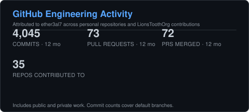
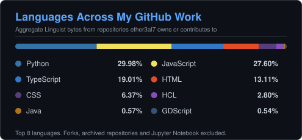

# Hi, I'm @ether3al7 👋

### Software Engineer | Full-Stack • Cloud • Infrastructure

I build software from idea to production, working across application development, APIs, cloud infrastructure, automation, testing, and deployment.

My work spans full-stack applications, AWS architecture, infrastructure as code, AI-enabled systems, developer tooling, and independent product development.

  <strong>💼 Portfolio:</strong>
  

  <strong>📫 Connect with me:</strong>
  

⚛️ Everything has a purpose.

---

## 🛠️ Current Tech Stack

### Development
Java • Python • JavaScript • TypeScript • React • Node.js • Spring • REST APIs

### Cloud & Infrastructure
AWS • Terraform • Docker • CI/CD • GitHub Actions • Cloud Architecture

### Engineering
Full-Stack Development • Automated Testing • Infrastructure as Code • System Design • Production Readiness

---

## 🚀 What I'm Building

I like building things that solve real problems, whether that's a full application, cloud platform, internal tool, or an experiment that started with:

> **"I could build that."**

My current work includes:

- Full-stack web applications
- AWS serverless and cloud-native systems
- Infrastructure automation with Terraform
- AI-enabled application architecture
- Business and productivity software
- Developer tools and engineering experiments

### 🌐 See What I'm Building

My portfolio is the best place to see my current projects, products, engineering work, and experiments.

### **[→ Explore My Portfolio](https://ryan.lionstoothtech.com)**

---

## 🧪 Field Labs

**Engineering, under controlled conditions.**

Field Labs started while I was looking through real freelance work and kept having the same thought:

**I could build that.**

Instead of stopping there, I started rebuilding interesting engineering problems from scratch.

The original work stays with the client. I take the engineering idea, recreate the problem using synthetic data and isolated environments, explore different approaches, test what works, and document what I learn.

Some labs are small. Others turn into deeper investigations.

The point is to keep building, stretch into unfamiliar problems, and become a better engineer by actually doing the work.

**[→ Enter Field Labs](https://ryan.lionstoothtech.com)**

---

## 🕰️ A Note About My Older Repositories

I've kept some of my earlier projects on GitHub intentionally.

They represent different stages of my development as an engineer and show how my approach to software has evolved over time.

Repositories marked **Legacy** reflect my skills and practices at the time they were created and may not represent my current standards for architecture, testing, security, infrastructure, or production development.

| Label | Meaning |
|---|---|
| 🟢 **Current** | Representative of my current engineering work |
| 🧪 **Lab** | Experiments, investigations, and learning projects |
| 🕰️ **Legacy** | Earlier work preserved as part of my engineering journey |
| 📦 **Archived** | Retired projects that are no longer maintained |

For the best representation of what I can build today:

### **[→ Visit My Portfolio](https://ryan.lionstoothtech.com)**

---

## 📊 GitHub Activity

---

## 🎓 Certifications

---

## 🔗 Find Me

🌐 **Portfolio:** [ryan.lionstoothtech.com](https://ryan.lionstoothtech.com)

💼 **LinkedIn:** [linkedin.com/in/ryanefaw](https://www.linkedin.com/in/ryanefaw/)

---

### ⚛️ Everything has a purpose.
